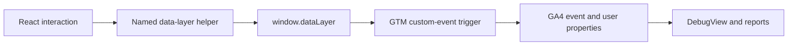

# Atelier Nord

Atelier Nord is a fictional Scandinavian-fashion storefront. It is a client-side React application with a local catalogue, persistent cart, simulated checkout, and Google Tag Manager (GTM) / Google Analytics 4 (GA4) tracking.

**Live deployment:** [ecommerce-26-ivory.vercel.app](https://ecommerce-26-ivory.vercel.app/)

## At a glance

| Area | What is included |
| --- | --- |
| Storefront | Five responsive React routes for discovery, product details, bag, and checkout |
| Catalogue | 28 local products across six fashion categories, with variants and sale pricing |
| Shopping | Persistent bag, quantity updates, shipping progress, and three demo coupon codes |
| Measurement | GTM and GA4 coverage for discovery, e-commerce, checkout, and supporting interactions |
| Delivery | Vite development/build workflow and a Vercel SPA deployment configuration |

## Shopper journey

| Stage | Visitor experience | Key measurement |
| --- | --- | --- |
| Discover | Browse the home page, categories, sales, search, and filters | `view_item_list`, `search`, `filter_products`, `sort_products` |
| Consider | Open a product and select its size or colour | `select_item`, `view_item`, `select_variant` |
| Build a bag | Add, remove, or adjust items; apply a coupon | `add_to_cart`, `remove_from_cart`, `view_cart`, coupon events |
| Checkout | Confirm shipping and payment choices through the simulated checkout | `begin_checkout`, `add_shipping_info`, `add_payment_info` |
| Complete | Review the order and receive a local confirmation | Deduplicated `purchase` event |


## Tech stack

- React 19, Vite 6, and React Router 7
- React Context and `useReducer` for cart state
- Plain CSS and `lucide-react`
- Browser `localStorage` for cart, coupon, order, purchase-deduplication, and user-property state
- GTM, GA4, and Vercel

## Project structure

```text
.
├── docs/                         # Tracking plan, learnings, challenges, and validation captures
├── gtm/                          # Versioned GTM container export
├── public/
│   └── images/                   # Local product and editorial images
├── src/
│   ├── analytics/                # Named data-layer tracking helpers
│   ├── components/               # Reusable cart, product, and shared UI components
│   ├── context/                  # Cart context and reducer
│   ├── data/                     # Products, categories, coupons, and image mappings
│   ├── hooks/                    # Shared React hooks
│   ├── pages/                    # The five route-level views
│   ├── styles/                   # Global styles and design variables
│   ├── utils/                    # Pricing, storage, item mapping, and order generation
│   ├── App.jsx                   # Route composition and shared layout
│   └── main.jsx                  # Application entry point
├── .env.example                  # GTM environment-variable template
├── index.html                    # Document shell, data-layer bootstrap, and GTM snippet
├── PROJECT_TASK.md               # Build requirements and release checklist
├── vercel.json                   # SPA rewrite for Vercel
└── vite.config.js                # Vite configuration
```

## Run locally

Requires Node.js 18+ and npm.

```bash
npm install
npm run dev
```

Vite serves the app at [http://localhost:3000](http://localhost:3000). If PowerShell blocks `npm.ps1`, run `npm.cmd run dev` instead.

To load GTM locally, create an untracked `.env` file from `.env.example`:

```env
VITE_GTM_ID=GTM-XXXXXXXX
```

Restart the development server after changing this value. `VITE_GTM_ID` is bundled into the client, so it is not a secret; do not commit `.env` regardless.

### Production build

```bash
npm run build
npm run preview
```

The project currently has no automated test scripts. Validate the shopping and tracking flows described in the documentation before a release.

### Validation status

The supplied evidence shows GTM Preview firing the page, product, cart, checkout, purchase, and supporting interaction tags during a representative journey. GA4 DebugView captures confirm received page-view, e-commerce, custom-event, purchase-parameter, and user-property data. See [validation screenshots](docs/Screenshots) for the recorded captures.

## Routes and catalogue controls

| Route | Purpose |
| --- | --- |
| `/` | Home, category links, featured products, and sale entry points |
| `/shop` | Catalogue, search, category, sale, price, and sort controls |
| `/product/:id` | Product details, variants, quantity, and add-to-bag |
| `/cart` | Bag contents, coupon entry, shipping progress, and totals |
| `/checkout` | Details, shipping, payment, review, and confirmation steps |

Unknown paths redirect to `/`; confirmation remains the final checkout step rather than a separate route.

`/shop` keeps its controls in the URL. Supported parameters are `category`, `sale=1`, `q`, `price` (`under-1500`, `1500-3000`, or `above-3000`), and `sort` (`price-asc`, `price-desc`, `discount-desc`, or `newest`). The default view uses featured-first sorting.

## Pricing and checkout

Product prices and discounts come from the local catalogue. Cart totals are calculated in `src/utils/pricing.js` in this order: item subtotal, coupon discount, shipping, 5% tax, then total.

| Demo code | Benefit |
| --- | --- |
| `WELCOME10` | 10% off, capped at INR 500, on an INR 1,500+ subtotal |
| `NORD500` | INR 500 off an INR 4,000+ subtotal |
| `FREESHIP` | Free standard shipping |

Standard shipping is free from an INR 2,999 discounted subtotal; otherwise it costs INR 99. Express shipping costs INR 199. Coupon discounts are allocated across checkout and purchase items only so GA4 item revenue reconciles to the event value without altering displayed prices.

## Analytics

Application code sends all tracking through [`src/analytics/dataLayer.js`](src/analytics/dataLayer.js). Components call named helpers rather than writing to `window.dataLayer` directly. Each e-commerce event first clears the previous `ecommerce` object, includes INR currency where relevant, and never sends an empty `items` array.



Implemented recommended events include `view_item_list`, `select_item`, `view_item`, `add_to_cart`, `remove_from_cart`, `view_cart`, `begin_checkout`, `add_shipping_info`, `add_payment_info`, `purchase`, and `search`. Supporting custom events cover virtual page views, filtering, sorting, variant selection, cart quantity changes, coupon outcomes, checkout errors, shipping selection, CTA clicks, and free-shipping progress.

The initial page view comes from the Google tag. Later route changes produce `virtual_page_view`, which GTM maps to GA4 `page_view`; browser-history page-view measurement should remain disabled. User properties are `visitor_type`, `has_purchased`, `preferred_category`, and `preferred_size`.

Customer names, email addresses, phone numbers, street addresses, payment details, and raw free text are deliberately excluded from analytics. Search terms are normalised and rejected when they resemble an email address or phone number; only recognised demo coupon codes are sent.

### GTM and GA4 configuration

The GTM bootstrap is installed in [`index.html`](index.html). The versioned GTM container export is available at [`gtm/gtm-container-export.json`](gtm/gtm-container-export.json); import it into the intended GTM account, review the GA4 measurement ID and triggers, and publish only after Preview validation.

In GA4, use INR and India Standard Time, disable browser-history page changes and enhanced-measurement site search, and register the custom dimensions listed in the tracking plan. Validate tag firing in GTM Preview and inspect the payloads in GA4 DebugView after every tracking change.

## Deployment

[`vercel.json`](vercel.json) rewrites every path to `index.html`, allowing React Router refreshes to work in a Vercel deployment. Build with `npm run build`, publish `dist`, and configure `VITE_GTM_ID` in the deployment environment.

## Project documentation

- [Project build notes](PROJECT_TASK.md) — product scope, implementation rules, and release checklist
- [Tracking plan](docs/TRACKING_PLAN.md) — event, parameter, item, user-property, and custom-dimension reference
- [Challenges](docs/CHALLENGES.md) — implementation and validation issues encountered
- [Learnings](docs/LEARNINGS.md) — analytics and GTM takeaways
- [Validation screenshots](docs/Screenshots) — GTM Preview, GTM configuration, GA4 DebugView, Realtime, and custom-dimension evidence

## Scope and limitations

This is a demo storefront: products, inventory, orders, and checkout are local simulations. Client-side measurement can be blocked by privacy tools or ad blockers, and browser-storage purchase deduplication cannot prevent duplicates across separate browsers or devices.
